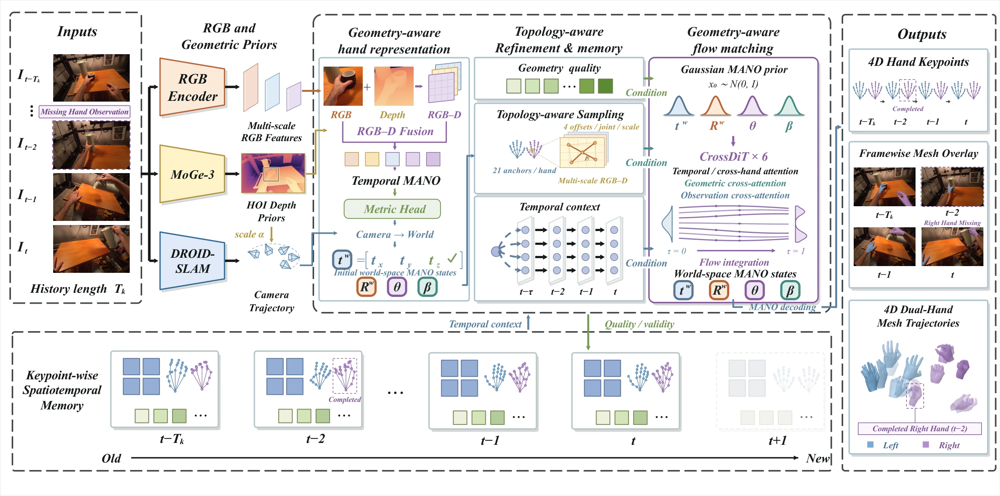
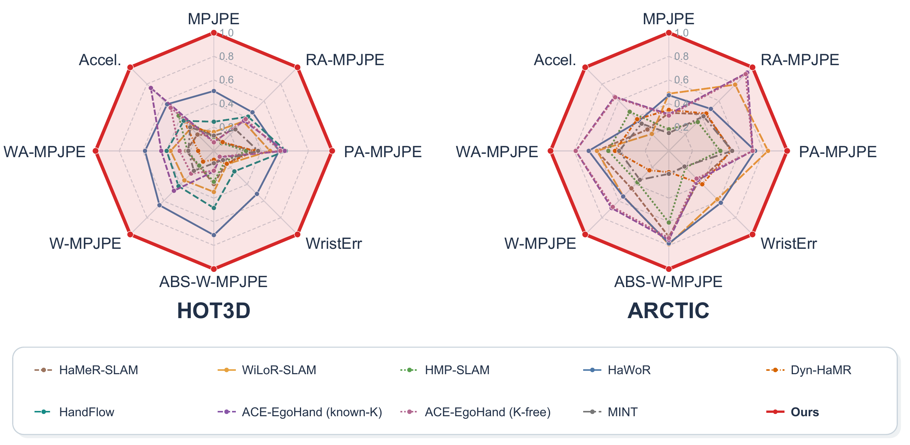
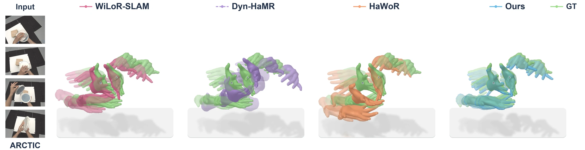

<h1 align="center">MetricHand</h1>
<h3 align="center">Geometry-Aware Flow Matching for 4D Hand Reconstruction in Metric World Space</h3>

  Yibo Bai1, Likui Zhang2, Jinglei Zhang3, Zhengbin Pang1, 
  Xingshen Song1,*, Xiaoqing Yin1, Jinsheng Deng4,*

  1 National University of Defense Technology 
  2 Sun Yat-sen University &nbsp; 3 Shanghai Jiao Tong University 
  4 Academy of Military Sciences 
  * Corresponding authors

  <a href="https://arxiv.org/abs/2611.21060">Paper</a> ·
  <a href="https://bieber1205.github.io/MetricHand/">Project Page &amp; Demos</a>

<strong>Code is coming soon.</strong>

## Architecture

Geometry priors condition metric estimation and temporal generation for 4D hand reconstruction in metric world space.

## Quantitative Results

Camera-space and world-space reconstruction results on HOT3D and ARCTIC. See the project page for full result tables and metric definitions.

## Qualitative Results

Qualitative reconstruction comparisons from the paper. Interactive examples and synchronized method-comparison videos are available on the project page.
